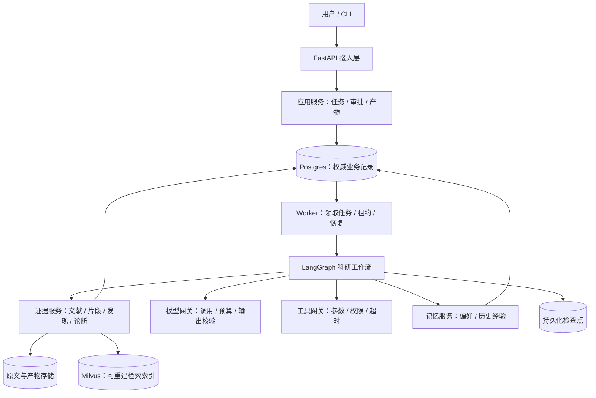
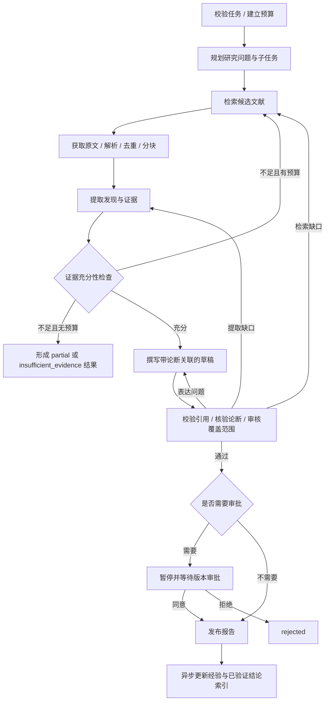

# 科研助手项目架构 V2

> 历史文档：保留设计与实施背景，当前结构请参阅 [目录说明](../architecture/directory-structure.md)。

设计状态：建议方案，尚未实现。适用于当前论文检索、文献阅读和研究报告生成场景。

## 1. 范围与设计原则

第一阶段面向个人或小团队、分钟级异步研究任务。规模、并发量及成本上限需通过实际负载确定，本方案不预设未经验证的吞吐能力。

目标是产出可追溯的研究报告，在进程中断、工具失败、人工拒绝时保持明确结果，支持独立重试失败阶段。

- 证据优先：报告中的事实性论断必须关联原文证据。
- 状态明确：会话、任务、执行和报告版本分别建模。
- 持久化优先：接受的任务先进入权威存储，再异步执行。
- 最小基础设施：先使用 Postgres、原文/产物存储和现有 Milvus；图数据库按实际查询需求引入。
- 工作流显式：LangGraph 负责节点编排，业务状态和持久化通过应用服务管理。
- 模型提供候选结果，程序执行权限、预算、版本和状态约束。

## 2. 部署与模块边界

采用模块化单体，同一代码库部署 API 和 Worker 两种进程。二者通过持久化任务记录衔接，共用业务接口，不依赖进程内全局变量传递状态。



图表示主要依赖，观测与审计贯穿 API、Worker 和所有网关。

| 模块 | 负责 | 不负责 |
|---|---|---|
| 接入层 | 身份、输入校验、提交、查询、审批、事件流 | 执行长任务、直接操作图状态 |
| 应用服务 | 任务生命周期、事务、幂等、审批版本校验、发布 | 提示词和模型选择 |
| Worker | 领取任务、租约续期、并发控制、取消、恢复调度 | 判断科研结论是否成立 |
| 工作流 | 顺序、条件、局部修订、阶段产物衔接 | 直接跨库写业务数据 |
| 证据服务 | 文献身份、版本、原文定位、发现和论断关联 | 将模型推断自动认定为事实 |
| 工具网关 | 类型化参数、资源权限、超时、错误分类、审计 | 将外部文本解释为控制指令 |
| 模型网关 | 模型配置、输出校验、调用预算、统一重试 | 任务最终状态、业务授权 |
| 记忆服务 | 用户偏好、历史执行经验、已验证结论的索引 | 替代源文献证据 |

## 3. 核心领域模型

### 3.1 身份与生命周期

| 对象 | 标识 | 含义 |
|---|---|---|
| 所有者 | owner_id | 用户或团队的数据边界，所有业务读取都带此范围 |
| 会话 | session_id | 一组交互及用户偏好；不等于执行检查点 |
| 研究任务 | task_id | 研究问题、要求、预算和发布策略 |
| 执行 | run_id | 一次执行尝试；重跑或修改配置产生新 run |
| 子任务 | subtask_id | 执行中的具体问题、依赖与阶段状态 |
| 报告版本 | report_version_id | 不可变草稿、证据关联及审核结果 |
| 审批 | approval_id | 对具体报告版本的同意或拒绝 |

使用 run_id 作为图执行的 thread_id。一轮内部修订属于同一 run，不创建新 run；人工要求重做、配置改变或重新研究创建新 run。任务保留全部历史 run，单独指向当前执行和已发布版本。

### 3.2 证据链

```text
SourceDocument → DocumentVersion → EvidenceChunk → Finding → Claim → ReportVersion
                                          ↑                   │
                                          └── ClaimEvidence ──┘
```

| 对象 | 必要字段 |
|---|---|
| SourceDocument | document_id、规范标识（DOI / arXiv 等）、标题、作者、来源 |
| DocumentVersion | version_id、内容哈希、抓取时间、原文位置、解析器版本、全文/摘要标记 |
| EvidenceChunk | chunk_id、version_id、页码/章节/字符位置、原文、内容哈希 |
| Finding | 问题、发现、证据 ID、适用条件、局限、是否为推断 |
| Claim | claim_id、报告中的论断、类型（事实/推断/建议）、验证状态 |
| ClaimEvidence | claim_id、chunk_id、支持/反驳关系、核验结果 |
| ReportVersion | 正文、论断关联、参考文献映射、审核结果、内容哈希 |

原文定位按文档类型定义：PDF 页码，HTML 的内容快照与段落位置，纯文本字符偏移。只有摘要时必须标明证据范围，不能视作已阅读全文。

引用编号在报告渲染时分配，内部使用稳定证据 ID。模型不得凭空构造合法引用；引用存在性和归属由程序校验，论断是否受证据支持由证据核验节点判断，并允许输出“无法判断”。

## 4. 科研工作流



partial 草稿可供用户查看，但不作为通过审核的最终报告自动发布。达到修订或成本上限时输出明确原因；语义核验持续不通过也可以结束为 partial。

### 4.1 节点契约

| 节点 | 输入 | 持久化产物 |
|---|---|---|
| Planner | 问题、要求、任务预算、偏好 | ResearchPlan：子任务、依赖、完成标准 |
| Retriever | 子问题、检索策略、时间与来源限制 | 搜索记录和候选文献 |
| Ingestor | 候选文献、授权资源范围 | 文献版本、解析结果、证据片段 |
| Reader | 子问题和证据片段 | Findings：发现、局限、支持与反驳证据 |
| EvidenceGate | 研究计划、发现、来源质量与覆盖情况 | 充分性判定、缺口清单 |
| Writer | 发现、证据、要求、写作反馈 | 不可变报告版本和论断关联 |
| Verifier / Reviewer | 报告论断、原文证据、任务标准 | 结构校验、语义核验、修订行动 |
| Publisher | 已通过版本、审批记录、发布策略 | 已发布产物引用与任务终态 |

Reader、Writer、Reviewer 是具有固定输入输出的模型节点。检索执行、解析、引用映射、发布、状态转换使用确定性服务。暂不引入额外 Coordinator 或辩论流程。

### 4.2 修订与并行

反馈使用类型化动作：retrieve_more、extract_again、rewrite、stop，并携带目标子任务、论断 ID 和原因。重试和修订分别计数；只有修订消耗 revision_budget。

第一阶段按顺序执行，先验证正确性。之后仅对独立检索/阅读子任务并行：依赖完成才启动；失败只重跑受影响分支；结果按稳定 ID 合并。Worker 有并发上限，模型网关另有调用并发上限。

## 5. 状态、审批与取消

业务执行状态：

```text
queued → running → waiting_approval → completed
                 ↘ rejected（拒绝审批）
                 ↘ partial（已有可查看产物但未满足完成标准）
                 ↘ insufficient_evidence（无足够证据形成有效报告）
                 ↘ failed（技术失败且恢复预算耗尽）
queued / running / waiting_approval → cancelled
```

waiting_approval 到 rejected 需要有效拒绝审批；running 可因预算耗尽进入 partial、insufficient_evidence 或 failed。以上状态属于 run，任务展示当前 run 状态，并独立保留已发布版本。

- 每次状态转换使用持久化版本号或条件更新，防止竞争写入。
- 审批绑定 report_version_id、内容哈希和 owner_id；重复同意幂等，冲突决定拒绝。
- 审批只接受 waiting_approval 对应版本。产生新版本后，旧审批不适用。
- waiting_approval 释放 Worker 执行资源。过期审批按任务策略取消，不自动批准。
- 取消是持久化请求；Worker 在调用边界检查，已开始的外部调用可能完成，但其结果不得继续触发发布。
- 有需人工授权的工具时，工具执行前单独审批，不能由报告审批代替。

## 6. 存储与一致性

| 存储 | 数据角色 | 故障策略 |
|---|---|---|
| Postgres | 任务、run、阶段记录、审批、证据元数据、事件、幂等记录的权威存储 | 不可用时不接受新任务，不用内存假装持久化成功 |
| 检查点后端 | LangGraph 的运行快照，按 run_id 隔离 | 无可恢复快照时记录失败，按新 run 重执行策略处理 |
| 原文/产物存储 | 不可变原文、解析快照、报告；本地可用受管理目录，部署可换对象存储 | 保留校验哈希，访问受所有者权限控制 |
| Milvus | 证据片段等的检索索引，可从原文及元数据重建 | 可按已授权原文做有限检索；明确标记降级或暂停 |
| Redis（可选） | 缓存、限流、调度通知 | 不作为任务是否存在和是否完成的唯一依据 |

初期调度使用 Postgres 中的持久化工作记录和租约。后续若引入消息队列，Postgres 事务同时写业务变化与 outbox 事件，由发送器投递；消费者仍需幂等。

外部执行按至少一次考虑。幂等键由 run_id、阶段、输入哈希和配置版本构成。外部调用后进程崩溃可能导致再次调用，因此不能宣称模型调用恰好一次；具有副作用的工具必须提供幂等或补偿机制。

阶段产物成功落库后，检查点引用其 ID。两者无需跨库原子事务：恢复时检查已提交产物，避免重复提交；缺失或不匹配时显式报错或重执行该阶段。业务状态不得仅凭图快照推断。

报告发布是业务事务：验证审核及审批、核验产物存在、登记发布版本、完成 run，并生成后续记忆更新事件。记忆更新失败独立重试，不撤销已发布报告。

## 7. 记忆与上下文

第一阶段只保留三种用途：会话偏好、历史任务经验、带证据引用的已验证结论。实体图谱暂不引入。

- 会话状态：交互记录与当前任务偏好，与任务执行快照分开。
- 用户偏好：篇幅、语言、研究关注点；不得覆盖本次明确要求。
- 历史经验：检索策略、失败原因、有效来源；不直接作为事实引用。
- 已验证结论：只保存可回到证据链的索引，使用时检查来源与版本状态。

记忆带 owner_id、来源、创建时间、验证状态及失效信息。删除原始任务或文档时按保留策略清理相关记忆与派生索引。未经验证的模型输出不能自动晋升为可信知识。

上下文由各节点分别组装：Planner 看要求与偏好，Reader 看原文片段，Writer 看发现与证据映射，Verifier 看论断及其原文。按所选模型计算 token 预算，保留输出空间；原文不通过简单截断代替分块。外部文本作为数据处理，不具有系统指令或工具授权效力。

## 8. 安全与资源控制

工具请求包含类型化参数与执行上下文：owner_id、run_id、授权资源、deadline、幂等键。工具授权由应用服务产生，模型不能设置 authorized=true。

- 文件工具只读取授权上传文件或受管理目录，检查规范路径、大小与格式。
- URL 获取检查目标与重定向，阻止访问未经授权的内部资源。
- 原文、报告、审计和事件流读取均执行所有者权限检查。
- 写入、发布等工具按动作及具体参数批准，超出批准范围重新授权。
- 日志不保存密钥；发送到外部模型或追踪服务的文本遵循任务数据策略。

任务预算包括：总 deadline、最大调用次数、最大 token 或成本额度、文献数、并发数、最大修订次数。Worker 与模型网关共享持久化预算账本，调用前预留额度，调用后按实际用量结算；无法确定的调用记录为待对账。取消、租约失效或预算耗尽阻止后续调用。

只有可恢复错误重试。认证失败、参数错误和权限拒绝不盲目重试；网关承担统一重试策略，避免调用层层叠加重试。

## 9. 恢复、回放与观测

三种操作分别提供接口与记录：

| 操作 | 行为 |
|---|---|
| 恢复 | 同一 run 从已提交阶段或检查点继续，检查租约和副作用幂等 |
| 回放 | 读取已保存输入输出，不调用外部工具、不重新发布，用于诊断 |
| 重新执行 | 新 run，使用当前或指定配置调用服务，保留与旧 run 的关系 |

记录关联 ID、阶段输入哈希、提示词版本、模型配置、工具响应/快照、输出、耗时、用量、错误类型和状态变化。对敏感正文按策略限制保存和访问。所谓回放只保证重现保存的记录，不承诺再次调用模型得到相同输出。

观测服务故障不阻断研究；关键审批和发布审计作为业务事务记录，不能因追踪服务不可用而丢失。

## 10. API 建议

| 接口 | 用途 |
|---|---|
| POST /research | 携带幂等键提交任务，持久化后返回 task_id 和 run_id |
| GET /research/{task_id} | 当前状态、执行记录、已发布版本和失败原因 |
| GET /runs/{run_id}/events | 按事件序号恢复的 SSE 进度流 |
| POST /runs/{run_id}/cancel | 请求取消 |
| GET /reports/{report_version_id} | 查看报告、证据关联与验证结果 |
| POST /reports/{report_version_id}/approval | 同意或拒绝该版本 |
| POST /research/{task_id}/runs | 创建一次新执行 |

相同所有者下，相同幂等键及请求哈希返回原任务；相同键配不同请求返回冲突。API 不在请求线程同步恢复整条图，审批写入决定与调度记录，由 Worker 继续执行。

## 11. 代码目录建议

```text
research_agent/
  api/                 # 路由、认证、请求与响应模型
  application/         # 任务、审批、发布、取消用例
  domain/              # 状态机、研究计划、证据、报告、预算模型
  workflows/           # LangGraph 图、节点、局部修订路由
  agents/              # Planner、Reader、Writer、Verifier 的提示词与输出适配
  evidence/            # 文献规范化、解析、分块、证据关联
  retrieval/           # 搜索策略、索引检索、重排接口
  memory/              # 偏好、经验、已验证结论索引、节点上下文
  gateways/            # 模型与工具执行接口
  infrastructure/      # 仓储、检查点、原文存储、向量库适配
  worker/              # 领取任务、租约、恢复、并发、取消
  observability/       # 事件、审计、日志、指标
  evaluation/          # 科研质量评测与固定证据集
```

这是职责边界，不要求立即为每个名称创建独立包。按迁移阶段拆分，避免只改目录而没有明确接口。

## 12. 验收与演进

### 阶段一：正确执行与可信报告

修复现有循环、拒绝审批和评测问题；建立 task/run/report_version 模型、权威任务记录、Worker 与持久化检查点；补齐原文片段、发现和论断关联；设置完成标准与预算。

验收：持续拒审会在修订预算内结束；人工拒绝不发布、不沉淀可信结论；无证据不输出 completed；重启可恢复任务；同请求幂等；错误引用不会静默被过滤成正确结果。

### 阶段二：可靠性与质量验证

增加租约、阶段幂等、取消、审批并发保护、存储故障恢复和证据语义核验评测。建立固定原文测试集及少量真实外部服务集成测试。

验收：Worker 被终止后任务可重新领取；重复执行不重复提交业务产物；过期审批不能发布新版本；已发布任务不因记忆失败变成失败；不同所有者不能跨范围读取证据。

质量指标分开计算：引用有效率、论断证据支持率、研究问题覆盖率、技术完成率、人工通过率、成本与延迟。明确分母；无可评测引用标为不适用，失败样本不计作满分。语义支持率使用人工标注集校准，不能完全依赖同一个生成模型自评。

### 阶段三：有依据的扩展

按瓶颈引入并行检索/阅读、缓存、混合检索与重排。仅在任务确实依赖多跳关系查询时引入 Neo4j；仅在固定评测上有可重复质量收益时引入辩论。用户量及故障隔离需求足够明确后，再考虑微服务或独立消息队列。

架构选择的主要权衡：模块化单体降低部署与一致性复杂度，但 API 和 Worker 仍需单独扩容；Postgres 调度减少早期组件数量，但高吞吐需求可能促使迁移队列；证据链增加存储与核验成本，但它是报告可审查性的基础。
